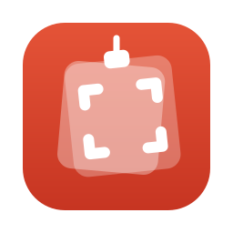
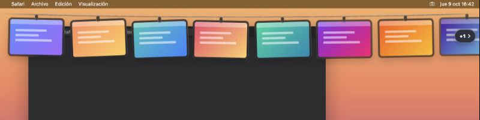
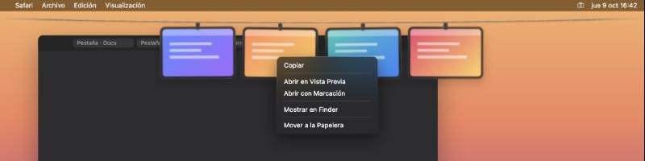

<p align="center">
  
</p>

# Screenshooter

App de barra de menús para capturas de pantalla en macOS: seleccionas un área, se copia al portapapeles y queda colgada en una Tira de tarjetas desde la que puedes reutilizarla.



## Requisitos

- macOS 14 (Sonoma) o posterior.
- Mac con Apple Silicon o Intel (binario universal).

## Instalación

1. Descarga el `.dmg` de la última versión en la [página de Releases](https://github.com/marfepa/Screenshooter/releases/latest).
2. Ábrelo y arrastra `Screenshooter.app` a la carpeta Aplicaciones.

### Primera apertura: aviso de seguridad

Screenshooter no está notarizada por Apple, así que macOS mostrará un aviso la primera vez. Hay dos formas de abrirla:

**Método 1: desde Ajustes del Sistema**

1. Intenta abrir la app (macOS la bloqueará).
2. Ve a Ajustes del Sistema → Privacidad y seguridad.
3. Junto al aviso sobre Screenshooter, pulsa «Abrir igualmente».

**Método 2: desde Terminal**

```bash
xattr -dr com.apple.quarantine /Applications/Screenshooter.app
```

### Verificar la descarga (opcional)

Descarga también el archivo `.sha256` de la release y, desde la misma carpeta:

```bash
shasum -a 256 -c Screenshooter-X.Y.Z.dmg.sha256
```

## Permisos

Screenshooter necesita el permiso de Grabación de pantalla (Ajustes del Sistema → Privacidad y seguridad → Grabación de pantalla). La app te guía hasta ese panel. Tras concederlo, reinicia la app (el menú de la barra tiene una opción para ello).

## Uso

Screenshooter vive en la barra de menús. La primera vez que la abres, una bienvenida a pantalla completa te enseña los gestos sobre tu propio escritorio; puedes volver a verla con «Cómo funciona…» en el menú.

- `⌥⌘S`: captura un área. Se copia al portapapeles y se cuelga en la Tira. Es un modo de captura continua: puedes seleccionar áreas una tras otra hasta pulsar `ESC`.
  - Toca el trackpad con dos dedos (o gira la rueda) para apartar la captura: puedes hacer scroll o cambiar de app y, si no haces nada o mueves el puntero, vuelve sola para seguir seleccionando.
  - Vuelve a pulsar `⌥⌘S` para navegar libremente con el modo activo (aparece una píldora «Navegando» con el botón Salir); otro `⌥⌘S` y sigues capturando.
- Captura larga: mantén `⇧` al soltar la selección (o elige «Captura larga…» en el menú) y haz scroll tú mismo; Screenshooter cose lo que va apareciendo en una sola imagen alta (páginas web, chats, listas). Pulsa «Listo» o `↩` para terminar y `ESC` para cancelar.
- `⌃⌥T`: muestra u oculta la Tira. Al llevar el puntero a la parte superior de la pantalla, la Tira también se desliza hacia abajo.

Gestos sobre cada captura de la Tira:

- Clic: copiar al portapapeles.
- Doble clic: abrir en Vista Previa.
- Mantener pulsado (o botón del lápiz): anotar con Markup de macOS.
- Arrastrar y soltar: llevar la imagen a Slack, Figma, Finder, etc.
- Botón ✕: descartarla.

Desde el menú también puedes activar el inicio al abrir sesión.

## Capturas



*Las imágenes proceden de la maqueta de diseño (`mockup/tira.html`); la app real puede variar en detalles.*

## Compilar desde el código

```bash
brew install xcodegen
xcodegen generate
open Screenshooter.xcodeproj
```

O genera directamente el `.dmg` universal en `build/`:

```bash
scripts/release.sh
```

## Publicar una versión

1. Sube `CFBundleShortVersionString` en `Screenshooter/Resources/Info.plist`.
2. Crea y sube el tag:

   ```bash
   git tag vX.Y.Z
   git push origin vX.Y.Z
   ```

3. GitHub Actions compila, empaqueta y publica la release con el `.dmg` y su checksum. Un tag con sufijo (por ejemplo `vX.Y.Z-rc1`) se publica como pre-release.

## Licencia

MIT, ver [LICENSE](LICENSE). El diseño de la Tira y parte de su código se inspiran en [Tendedero](https://github.com/alejandrobujan/tendedero) de Alejandro Buján (MIT); ver [NOTICE](NOTICE).
